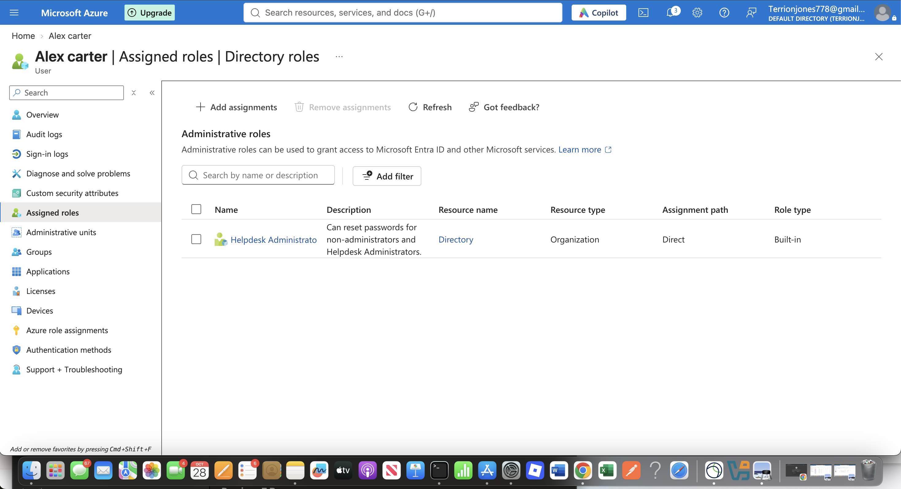
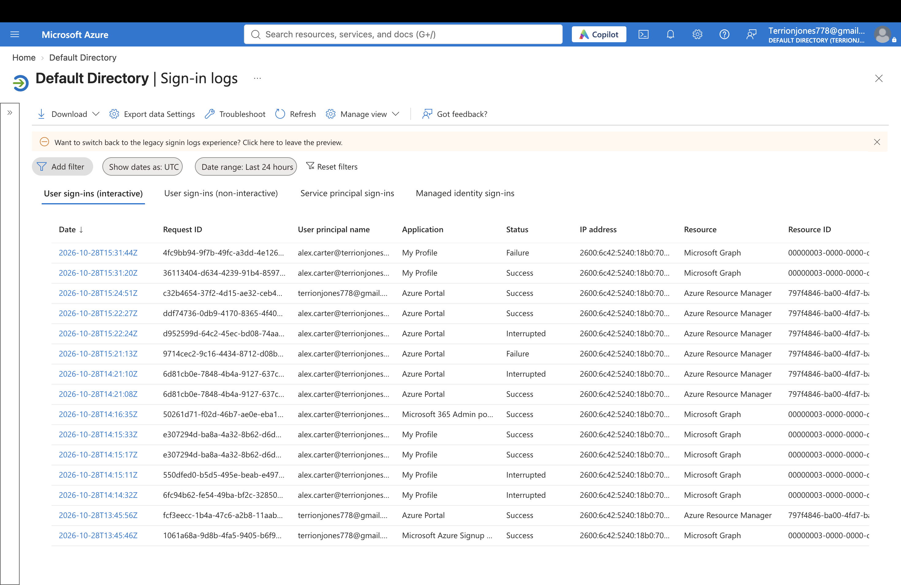

# Microsoft Entra ID — Cloud Security & IAM Lab

Cloud Identity and Access Management cybersecurity

## Project Overview

This project demonstrates hands-on experience with cloud Identity and Access Management (IAM) using Microsoft Entra ID.

I created a simulated company called **TJ Tech Solutions** to practice managing employee identities, implementing role-based access control, configuring multifactor authentication, and investigating authentication events.

## Technologies Used

- Microsoft Entra ID
- Microsoft Azure
- Microsoft Authenticator
- Identity and Access Management (IAM)
- Role-Based Access Control (RBAC)
- Multifactor Authentication (MFA)
- Microsoft Entra Sign-in Logs

## Lab Implementation

### 1. User and Group Management

Created six fictional employee accounts organized into three departments:

- IT
- Human Resources
- Finance

Configured three security groups to organize employee access.

### 2. Role-Based Access Control

Assigned the Helpdesk Administrator role to a test employee, Alex Carter, and verified the role assignment.

This demonstrated the principle of least privilege by assigning specific administrative permissions rather than unrestricted access.

### 3. Multifactor Authentication

Verified that Microsoft Entra security defaults were enabled.

Registered Microsoft Authenticator for Alex Carter and successfully tested authentication.

### 4. Security Monitoring

Used Microsoft Entra sign-in logs to investigate authentication activity.

- Identified successful sign-in events.
- Identified failed sign-in events.
- Verified MFA satisfaction during successful authentication.
- Reviewed authentication outcomes.

The failed sign-in cause was not determined, and no malicious activity was confirmed.

## Security Investigation Report

[View Authentication Investigation Report](reports/authentication-investigation.md)

## Skills Demonstrated

- Cloud Identity Administration
- User and Security Group Management
- Role-Based Access Control
- Least-Privilege Security
- Multifactor Authentication
- Authentication Log Analysis
- Security Documentation

## Future Improvements

- Investigate authentication failure codes.
- Review Microsoft Entra audit logs.
- Explore Conditional Access policies in a suitably licensed environment.
- Expand identity security monitoring exercises.

## Conclusion

This project provided practical experience administering cloud identities and analyzing authentication events in a simulated enterprise environment.

It demonstrates foundational skills relevant to cybersecurity internships, cloud security, identity administration, and SOC analyst roles.
